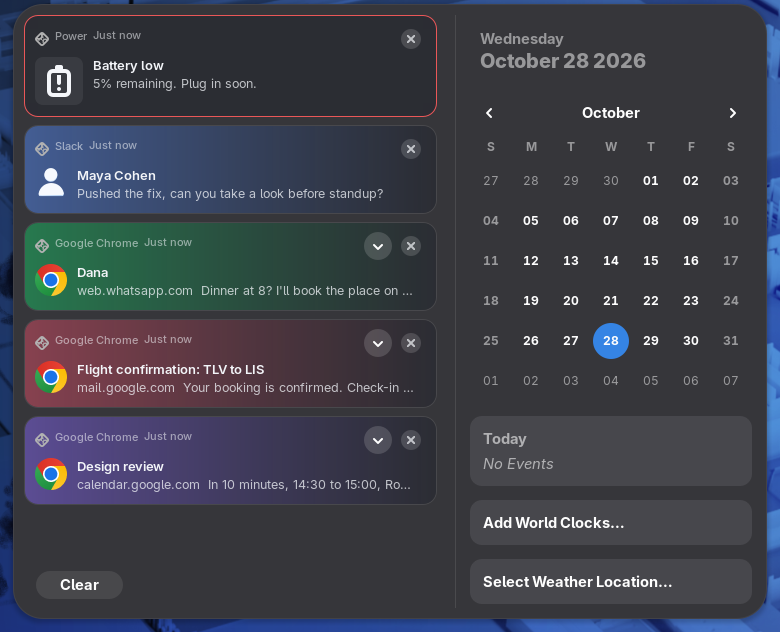
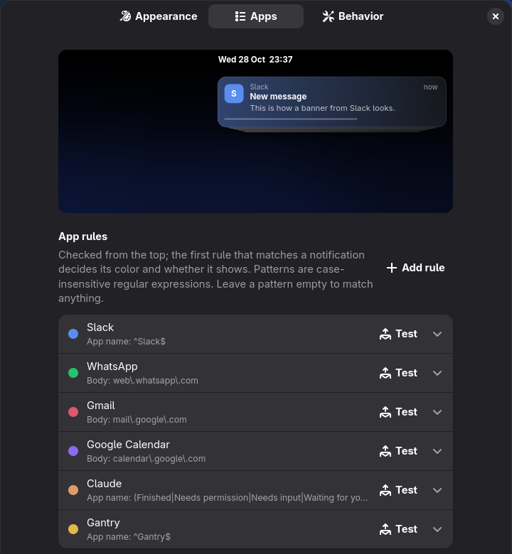

# Better GNOME Notifications

Notifications that don't queue up. Instead of GNOME's one wide banner at the
top of the screen, notifications arrive as a stack of narrow frosted cards in
the corner you pick, each tinted with its app's color and leaving on its own
timer. Hover the stack to fan it out and read everything; critical
notifications stand out in red.


## Features

- **A stack, not a queue.** Up to five cards on screen at once, newest in
  front. A burst no longer waits behind the first banner or gets dropped.
- **Hover to read.** Pointing at the stack fans it out and pauses every timer.
  The card under the pointer opens to show its full text and buttons.
  Right-click a card to dismiss it.
- **Each card on its own timer.** 5 seconds by default, 30 for critical ones,
  with an optional line that shrinks as time runs out. Timers wait until
  you're back at the computer.
- **App colors and rules.** Give each app a color, and choose whether its
  notifications show, go quietly to the notification list, or are blocked.
- **Fewer interruptions.** After an app shows a banner, its next
  notifications for a moment go straight to the list.
- **One list entry per notification.** The notification list stops grouping
  notifications by app, and its entries take the same colors and look as the
  banners. Both can be turned off.



Do Not Disturb works as usual, and notifications that arrive while the screen
is locked show up once you unlock.

## Requirements

GNOME Shell 50. The test buttons in the settings use `notify-send` (from
libnotify, installed on most desktops).

## Install

1. Download `better-gnome-notifications@idogr.shell-extension.zip` from the
   [latest release](https://github.com/idogrf/better-gnome-notifications/releases/latest).
2. Install it:

   ```bash
   gnome-extensions install --force ~/Downloads/better-gnome-notifications@idogr.shell-extension.zip
   ```

3. Log out and log back in. GNOME only picks up newly installed extensions at
   login.
4. Turn it on in the **Extensions** app, or with:

   ```bash
   gnome-extensions enable better-gnome-notifications@idogr
   ```

To update, repeat steps 1 to 3 with the new release.

Turn off any other extension that moves or restyles banners (Notification
Configurator, Notification Banner Position and the like). They would fight
over the same banners.

## Settings

Open the settings from the gear icon in the **Extensions** app, or with
`gnome-extensions prefs better-gnome-notifications@idogr`. Each page starts
with a preview of the stack over your wallpaper that updates as you change
things.

- **Appearance:** position, frosted, see-through or solid cards, dark or light
  tone, text size, width and corner radius.
- **Apps:** your app rules. Rules are checked from the top and the first one
  that matches wins. A rule matches on the app name, title or body text, sets
  the card's color, and decides what happens: show, list only (no banner), or
  block. Web apps like WhatsApp or Gmail are matched by their body text, since
  the browser sends every site's notifications under its own name. A few
  rules for common apps come preset.
- **Behavior:** how many cards to stack, how long cards stay, the countdown
  line, the pause between an app's banners, and how the notification list
  looks.



To try your changes for real, **Send burst** sends a few notifications at
once, and each rule's **Test** button sends one that the rule matches. It
also tells you if something would keep it from showing, like an earlier rule
or Do Not Disturb.

## Good to know

- **The frosted look isn't used over the Activities overview.** Cards that
  arrive there use plain see-through glass instead.
- **Only the front card is frosted.** The cards behind it are plain glass.

## Uninstall

```bash
gnome-extensions uninstall better-gnome-notifications@idogr
dconf reset -f /org/gnome/shell/extensions/better-gnome-notifications/
```

The second line removes its saved settings.

## Build from source

```bash
git clone https://github.com/idogrf/better-gnome-notifications.git
cd better-gnome-notifications
sh pack.sh
```

This writes `dist/better-gnome-notifications@idogr.shell-extension.zip`.
Install it as in step 2 above.

## License

GPL-2.0-or-later. See [LICENSE](LICENSE).
